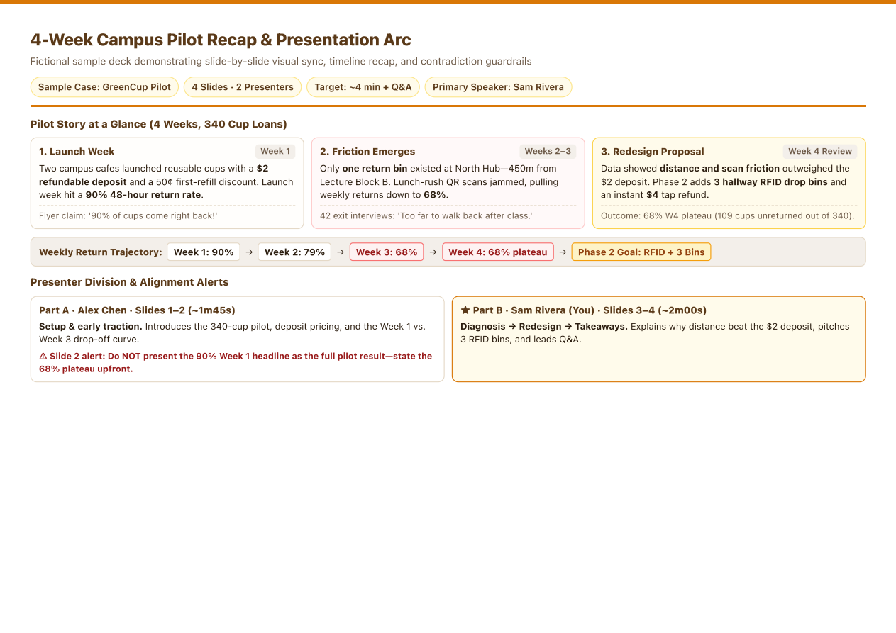
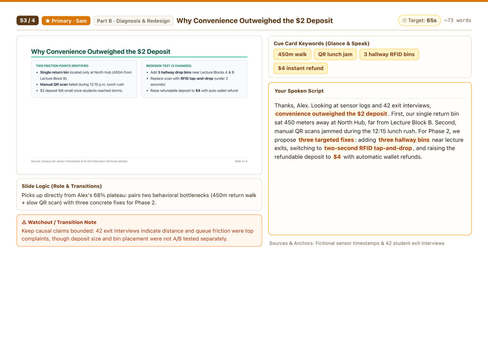

# Slide Rehearsal Deck

**Turn any PPT/PDF deck into a slide-by-slide visual rehearsal manual** — an offline interactive HTML cue deck plus a print-ready A4-landscape PDF, pairing every original slide beside its story recap, logic, contradiction guardrails, cue keywords, and paced spoken script.

> **把任意 PPT/PDF 变成逐页可视化演讲手卡** —— 同时输出零外网依赖的 **交互网页排练版（HTML）** 与 **一页一屏横版 PDF**，把原幻灯片高清图、故事背景复盘、前后逻辑、避坑红线、脱稿关键词和控时口语稿摆在同一屏。

---

## Previews / 效果预览

### 1. Opening Story Recap & Speaker Division Map（开篇复盘与逻辑总览页）


### 2. Slide-by-Slide Visual Cue Card & Paced Script（逐页原图对照与控时口语稿）


---

## Why This Skill? / 核心亮点

- **Original Slide Visual Sync**: Renders every page of your finalized PDF/PPTX inline (JPEG base64 in HTML — zero external CDNs or web fonts, opens offline anywhere).
- **Opening Story & Context Recap**: Optional Page 0 reconstructs complex case timelines, price/metric trajectories, and team division of labor so you never blank out on stage.
- **Contradiction & Guardrail Callouts**: Automatically flags slide-vs-evidence mismatches, outdated speaker notes, or overclaiming risks in high-contrast red/amber callout boxes.
- **Glanceable Cue Cards + Paced Scripts**: 3–4 cue keywords paired with vocal-stress bolded scripts calibrated to ~125–135 wpm (EN) / ~220–260 chars/min (ZH).
- **Interactive Rehearsal Controls**: Filter by presenter (`All` / `Primary` / `Co-presenters`), switch to keyboard **Focus Mode** (`←` / `→`), copy scripts in one click, and run a built-in countdown timer.
- **1-Page-Per-Slide Print Layout**: Exports cleanly to exact A4 Landscape (`297mm × 210mm`) PDF via Chrome/Chromium/Edge for iPad markup or printed cue sheets.
- **Bilingual UI (`"en"` / `"zh"`)**: Set `"language": "en"` or `"zh"` in `deck.json` to switch toolbar, headings, and callout labels automatically.

---

## Install as an Agent Skill / 安装为 Agent Skill

Works with **Antigravity**, **Claude Code**, **Codex**, and **Cursor** (`SKILL.md` progressive-disclosure format):

### Option A: `skills` CLI (Cross-Agent)
```bash
npx skills add Eizhong-SlideStudio/slide-rehearsal-deck
```

### Option B: Manual Clone (Workspace or Global)

```bash
git clone https://github.com/Eizhong-SlideStudio/slide-rehearsal-deck.git
```

Copy `skills/slide-rehearsal-deck/` into your agent's skill directory:

| Agent | Project-Level Path | Global Path |
| :--- | :--- | :--- |
| **Antigravity** | `.agents/skills/slide-rehearsal-deck/` | `~/.gemini/config/skills/slide-rehearsal-deck/` |
| **Claude Code** | `.claude/skills/slide-rehearsal-deck/` | `~/.claude/skills/slide-rehearsal-deck/` |
| **Codex** | `.agents/skills/slide-rehearsal-deck/` | `~/.codex/skills/slide-rehearsal-deck/` |
| **Cursor** | `.cursor/skills/slide-rehearsal-deck/` | `~/.cursor/skills/slide-rehearsal-deck/` |

Then ask your agent:
> *"Use `slide-rehearsal-deck` to turn `slides.pdf` and my background notes into a visual rehearsal manual (HTML + PDF)."*

---

## Standalone CLI Usage / 独立命令行使用

Requires Python 3.9+ with `pypdfium2` and `Pillow` (plus Chrome, Chromium, or Edge for `--out-pdf` export):

```bash
pip install pypdfium2 pillow

python skills/slide-rehearsal-deck/scripts/build_deck.py \
  --pdf skills/slide-rehearsal-deck/examples/demo-slides.pdf \
  --data skills/slide-rehearsal-deck/examples/demo-deck.json \
  --out-html ./demo-manual.html \
  --out-pdf ./demo-manual.pdf \
  --verify-dir ./verify_pngs
```

If Chrome/Edge is in a non-standard location, pass `CHROME_PATH=/path/to/chrome`. If no browser is installed, the script still builds the full offline interactive HTML (which you can open and `Cmd/Ctrl + P` → Save as PDF).

---

## Repository Layout / 目录结构

```text
slide-rehearsal-deck/
├── README.md
├── LICENSE
├── assets/
│   ├── preview-overview.png
│   └── preview-slide.png
└── skills/
    └── slide-rehearsal-deck/
        ├── SKILL.md                  # Agent workflow & quality guardrails
        ├── scripts/
        │   └── build_deck.py         # Cross-platform HTML + A4-landscape PDF engine
        ├── references/
        │   └── schema.md             # deck.json specification & pacing guide
        └── examples/
            ├── demo-slides.pdf       # Fictional 4-slide sample deck
            └── demo-deck.json        # Sample metadata, overview & scripts
```

---

## License

[MIT](LICENSE) © 2026 Eizhong
